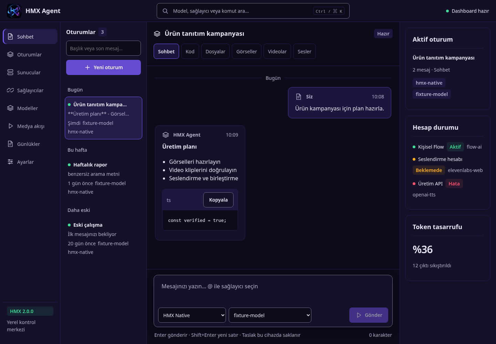
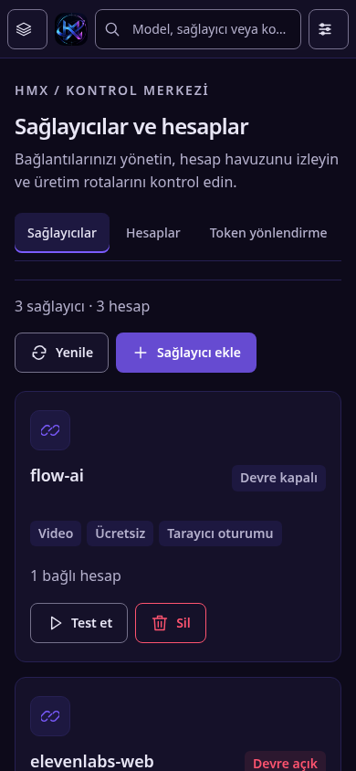

# Entegrasyon test raporu

## Ortam

Linux, Node 24, pnpm workspace, TypeScript 5.9, React 18, Chromium headless. Kilitli bağımlılıklar `pnpm install --frozen-lockfile --ignore-scripts` ile kuruldu. Yeni npm bağımlılığı eklenmedi; pnpm lockfile değiştirilmedi. Node >=20.3 gerekir (`AbortSignal.any`); 22+ önerilir.

Testler gerçek kullanıcı HMX_HOME, Chrome profili, API anahtarı veya GitHub kimlik bilgisini kullanmaz. Backend testleri geçici dizinde ve loopback mock OpenAI/medya servisinde çalışır. Compose testi gerçek yerel FFmpeg/ffprobe kullanır; ücretli üretim veya dış model çağrısı yapılmaz.

## Sonuçlar

| Kontrol                                        | Sonuç                                                                                                          |
| ---------------------------------------------- | -------------------------------------------------------------------------------------------------------------- |
| `pnpm build`                                   | Başarılı: tüm core paketleri + üretim Vite web build                                                           |
| `pnpm exec tsc -p apps/web/tsconfig.json`      | Başarılı; web TypeScript kontrolü                                                                              |
| `pnpm test` — mevcut test koşucusu             | **77 PASS, 0 FAIL**                                                                                            |
| `pnpm test` — node:test registry + entegrasyon | **41 PASS, 0 FAIL** (19 registry + 21 alt entegrasyon testi + 1 kapsayıcı test)                                |
| `node tests/e2e/ui.mjs`                        | **53 PASS, 0 FAIL**, runtime pageerror yok                                                                     |
| `pnpm --filter @hmx/desktop build`             | Başarılı: main/preload + CJS server bundle                                                                     |
| `node tests/e2e/desktop-smoke.mjs`             | Başarılı: bağımsız CJS server, 3 gerçek driver, modeller, logo/web servisleri                                  |
| Görsel QA                                      | 1440px masaüstü ve 390px mobil; sekiz rota ve seçili modal/loading/empty/error/onay/kuyruk durumları incelendi |
| `git diff --check`                             | Başarılı                                                                                                       |
| Değişen kaynaklarda credential desen taraması  | GitHub/OAuth/API secret desen eşleşmesi yok (genel DLP garantisi değildir)                                     |

Arayüz test adları ve tek tek sonuçlar [evidence/ui-results.json](./evidence/ui-results.json) içindedir. Backend test kaynakları `tests/professionalization.spec.ts` ve `tests/registry.spec.ts`; mevcut koşucu `tests/run.ts`'dir. Varsayılan e2e screenshot/JSON çıktıları `.qa/` dizinine yazılır.

## Backend kanıt kapsamı

- FIFO/concurrency=2; snapshot kopyası; listener hatası izolasyonu.
- Queued/running cancel, AbortSignal; handler bitmeden slot/retry açılmaması.
- Senkron handler hatası, failed/retry ve restart running→failed; bozuk jobs dosyası korunması.
- JSONL level filtreleme, child/meta, cycle/BigInt, gizli meta maskeleme, sabit alanların korunması, 5 MB rotasyon.
- Gerçek dosya okuma/listeme/yazma; workspace dışı yol, symlink ve .env engelleri.
- Hermes XML tool sonucu modele geri döner; gerçek final chatStream; tekrar hata, tur bütçesi, hedef hatırlatma ve context overflow recovery.
- OpenCode function-call/trace; onaysız write reddi **allow modunda da**; açık callback onayından sonra gerçek dosya yazma; plan/tekrar hata/bütçe.
- ModelRegistry cache/invalidate ve unavailable LLM fallback; gerçek HTTP agent/model listeleri.
- Settings key'i yanıtlamaz, boş alan key'i korur; quota env uygulanır, boş fallback env sırası temizlenir; URL/ID/policy/origin validasyonu.
- SSE gerçek yerel upstream token/done; bilinmeyen model reddi; riskli görev için tek kullanımlık onay; runtime SSE aracın yazmadan önce beklemesi; **client bağlantısı kesilince upstream LLM akışının kapanması**.
- Job API 202→done ve dosya/katalog; failed/retry/filter doğrulaması; gerçek FFmpeg iki yerel klibi birleştirir, ffprobe iki saniyelik çıktı doğrular.

## Web kanıt kapsamı

- Tam uygulamada sekiz rota, logo yüklemesi, 390px yatay/viewport taşmasının olmaması ve mobil panel erişimi.
- Yedi paket sayfasında ilk skeleton, API error/retry, boş kaynak ve aksiyon.
- Composer: boş/busy, @ klavye seçimi/highlight, IME, Shift+Enter, uzun mesaj uyarısı.
- Markdown HTML/XSS ve javascript URL çalıştırmaz; kod kopyası; tarih ayracı.
- Kısmi SSE hatası korunur; EOF açık hata; retry kullanıcı/assistant mesajını çoğaltmaz; inline onayda stream ticket taşınır; medya queue isteği.
- Oturum taslağı/seçimi, altı sekme, gallery boş hali; son mesaj arama, rename/F2, ok tuşları ve inline delete.
- Palette Ctrl+K, fuzzy `prv`, vurgular, recent, Escape; provider beş sekme, JSON validation, mock Chrome start/finish.
- Log arama/error/verify/pause; Pipeline doğrulanmış seçim ve sıralama, jobs cancel/retry.
- Settings politika kartları, quota 1–72, maskeli password, kaydedildi/hata toast, yinelenen zincir validasyonu, korunmuş form, iki onaylı yalnız-session reset ve wizard.

## Görsel örnekler

Aşağıdaki görüntüler **yerel test fixture'larıdır**. Örnek sağlayıcı/hesap sayıları gerçek kullanıcı üretim verisi değildir. Kaynak logo kullanıcının sağladığı HMX görselidir.

## Yapılmayan canlı kabul testleri

- Gerçek ücretli sağlayıcı üretimi veya mevcut Chrome profiline giriş yapılmadı.
- Gerçek uzak LLM araç uyumluluğu/yanıt kalitesi ölçülmedi. Yerel OpenAI uyumlu fixture ile entegrasyon sınandı.
- Windows Electron GUI, installer/portable EXE çalıştırılmadı ve imzalı release yayınlanmadı. Build/sunucu smoke testi Windows kabul testi yerine geçmez.
- Harici MCP/proxy yönetimi ve OpenCode genel tarayıcı aracı mevcut değil; [kapsam sınırları](./README.md).
- Bu rapor yerel test kanıtıdır; GitHub Actions check sonucu olduğu iddia edilmez.
